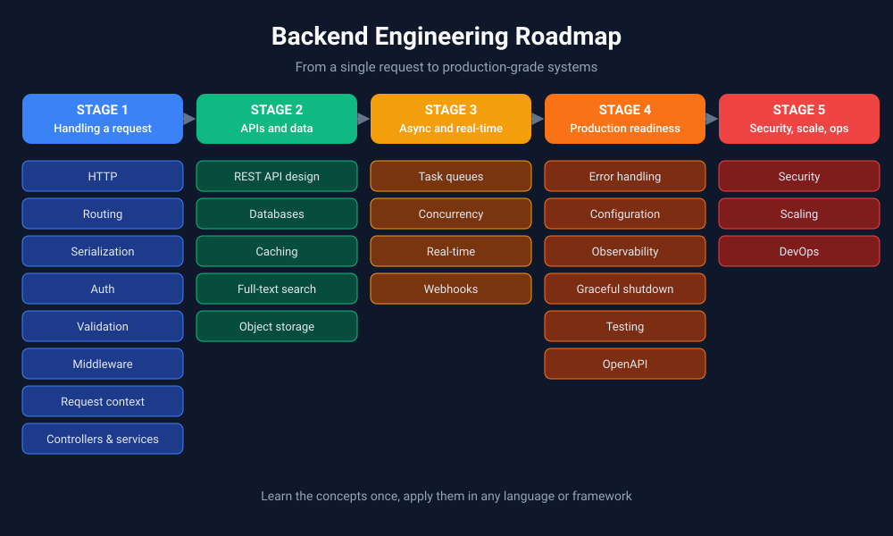

Backend engineering is much more than writing CRUD APIs. It is about building systems that are **reliable, scalable, fault-tolerant and easy to maintain**. This lesson is the map: it shows every major topic you will learn and how they fit together.

## Key ideas

- **Backend ≠ CRUD.** Creating, reading, updating and deleting data is just the start. Real backends also handle security, speed, failures and growth.
- **Learn concepts, not just frameworks.** If you only learn Express, Django or Spring Boot, you learn *their* way of doing things. If you learn the ideas underneath, you can pick up any language or framework quickly.
- **Most engineers learn this the hard way.** Through years of trial and error, books and reading other people's code. This roadmap shortcuts that.
- **Everything starts with a request.** A client sends a request, the server processes it, and sends back a response. Every topic below is about doing one part of that journey well.

## The roadmap, step by step

### 1. How a request travels
Your browser (the client) sends a request over the internet, through firewalls, to a server somewhere (like AWS). The server does some work and sends a response back. Understanding this round trip is the foundation for everything else.

### 2. HTTP: the language of the web
HTTP is the set of rules clients and servers use to talk. You'll learn:
- **Messages and headers:** a request/response has a body plus headers (extra info like content type or auth tokens).
- **Methods:** `GET` (read), `POST` (create), `PUT`/`PATCH` (update), `DELETE` (remove).
- **Status codes:** `200` OK, `201` Created, `404` Not Found, `500` Server Error, and so on.
- **CORS:** browser rules that decide which websites may call your API.
- **Caching, compression and versions:** ways to make responses faster (ETags, gzip/Brotli, HTTP/2 and HTTP/3).
- **HTTPS:** HTTP encrypted with TLS so nobody can snoop on the data.

### 3. Routing
Routing decides **which code runs for which URL**. `GET /users/42` goes to the "get one user" code. Routes can be static (`/about`), dynamic (`/users/:id`), nested or catch-all. You'll also learn API versioning (`/v1/users`) and grouping routes that share rules.

### 4. Serialization and deserialization
Servers and clients exchange data as text or bytes. **Serialization** turns your objects into a format like JSON; **deserialization** turns it back. JSON is easy to read; binary formats like Protocol Buffers are faster and smaller.

### 5. Authentication and authorization
- **Authentication:** *Who are you?* (passwords, sessions, JWT tokens, OAuth, API keys, MFA)
- **Authorization:** *What are you allowed to do?* (roles like admin/user, access lists)

Passwords are stored safely using **hashing and salting**, never in plain text.

### 6. Validation and transformation
Never trust incoming data. Check it first:
- **Syntactic:** is it the right format? (valid email)
- **Semantic:** does it make sense? (birth date is not in the future)
- **Type:** is the age actually a number?

Then clean it up: trim spaces, lowercase emails, convert strings to numbers. Client-side checks are for convenience; **server-side checks are for security**.

### 7. Middleware
Middleware are small functions that run **before or after** your main code on every request, like checkpoints. Common ones handle logging, authentication, security headers, compression and errors. **Order matters**: you want auth to run before the code that needs the user.

### 8. Request context
A small bag of data that travels with one request: the request ID, the logged-in user, headers and so on. It lets different parts of your code share info without passing it everywhere. Keep it small and clear it when the request ends.

### 9. Controllers, services and CRUD
- **Controllers (handlers)** receive the request, validate it, call the right logic and format the response.
- **Services (business logic layer)** hold the actual rules of your app, like "an order can't be placed if stock is zero."
- Keeping these separate makes code easier to test and change.

You'll also add pagination, sorting and filtering to list endpoints.

### 10. REST API design
Design APIs around **resources** (`/users`, `/orders`) and use HTTP methods and status codes the way they're meant to be used. Good APIs are predictable and consistent.

### 11. Databases
Where your data lives permanently. Key topics:
- Relational (Postgres, MySQL) vs non-relational (MongoDB, Redis)
- **ACID** (transactions you can trust) and the **CAP theorem** (trade-offs in distributed databases)
- Schema design, indexes, query optimization, connection pooling
- ORMs and migrations (safely changing your database structure over time)

### 12. Caching
Store frequently used data somewhere faster (memory, Redis, the browser) so you don't fetch it again every time. The hard part is knowing **when cached data is outdated** (cache invalidation) and what to throw out when space runs out (LRU, TTL).

### 13. Task queues and background jobs
Some work is slow: sending emails, resizing images, calling third-party APIs. Instead of making the user wait, put the job in a **queue** and let a background worker handle it. Includes retries, priorities and rate limits.

### 14. Full-text search with Elasticsearch
Databases are slow at searching text like "find products similar to *running shoes*." Elasticsearch is built for this, powering autocomplete, search bars and log analysis.

### 15. Error handling
Things will break. Good error handling means:
- Catching errors in one central place
- Showing users helpful messages (without leaking internal details)
- Logging errors so developers can fix them (tools like Sentry)

### 16. Configuration management
Keep settings (database URLs, API keys, feature flags) **out of your code**, in environment variables or config files. Secrets must be stored safely, and dev/staging/production should each have their own settings.

### 17. Logging, monitoring and observability
How you know what your system is doing in production:
- **Logs:** a written record of events
- **Metrics:** numbers over time (requests per second, error rate)
- **Traces:** following one request across many services

Tools: Prometheus, Grafana, the ELK stack. Alerts should be useful, not noisy.

### 18. Graceful shutdown
When a server is stopped or restarted, it should finish what it's doing first:
1. Stop accepting new requests
2. Finish requests already in progress
3. Close database connections and files
4. Exit

This prevents lost data and failed requests during deployments.

### 19. Security
Protect against common attacks: SQL injection, XSS, CSRF and broken authentication. Core principles: give the **least privilege** needed, use **multiple layers of defense**, and **fail safely**.

### 20. Performance, scaling and concurrency
- Find slow spots by measuring response times and resource usage.
- **Vertical scaling:** a bigger server. **Horizontal scaling:** more servers.
- **Concurrency** helps with waiting tasks (I/O-bound, like network calls); **parallelism** helps with heavy computation (CPU-bound).

### 21. Large files and real-time systems
- Store files like images and videos in **object storage** (e.g. AWS S3), using chunked or multipart uploads for big files.
- For live updates (chat, notifications), use **WebSockets**, **Server-Sent Events** or pub/sub systems.

### 22. Testing and code quality
Unit tests check small pieces; integration tests check pieces working together. TDD means writing tests first. CI/CD pipelines run tests automatically, and linters keep code style consistent.

### 23. OpenAPI
A standard file that **describes yo

ur API**: its endpoints, inputs, outputs and auth. It powers auto-generated docs (Swagger UI) and lets teams agree on an API before building it (API-first).

### 24. Webhooks
Instead of a client repeatedly asking "anything new?" (polling), the server **calls the client's URL** when something happens. Used by Stripe for payments and GitHub for repo events. Always verify webhook signatures.

### 25. DevOps basics
How code gets from your laptop to production:
- **CI/CD:** automatically test and deploy code
- **Docker:** package your app so it runs the same everywhere
- **Kubernetes:** run and manage many containers
- **Deployment strategies:** rolling, blue-green and canary releases to ship safely

## Takeaway

Don't try to learn all of this at once. Follow the path in order: understand how a request works, then learn to handle it well, then learn to make it **fast, safe and reliable** in production. Once you understand the concepts, every framework becomes just a different way of writing the same ideas.
